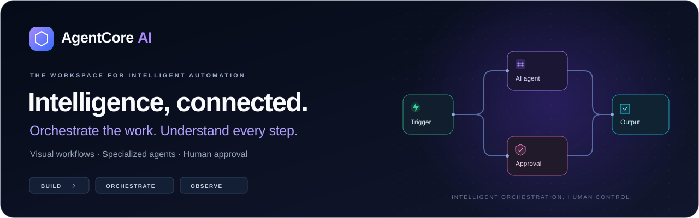
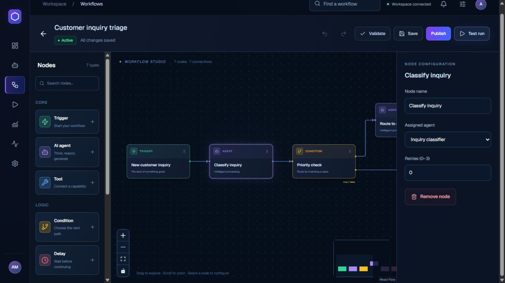
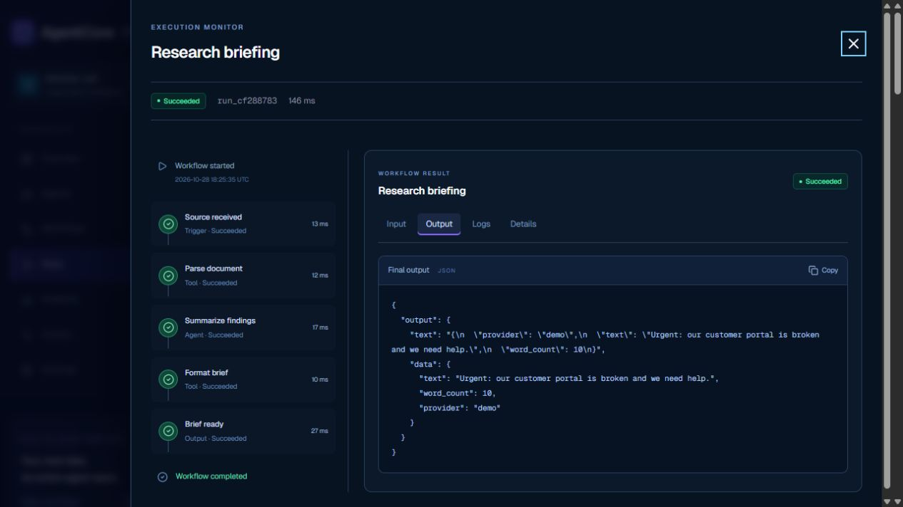
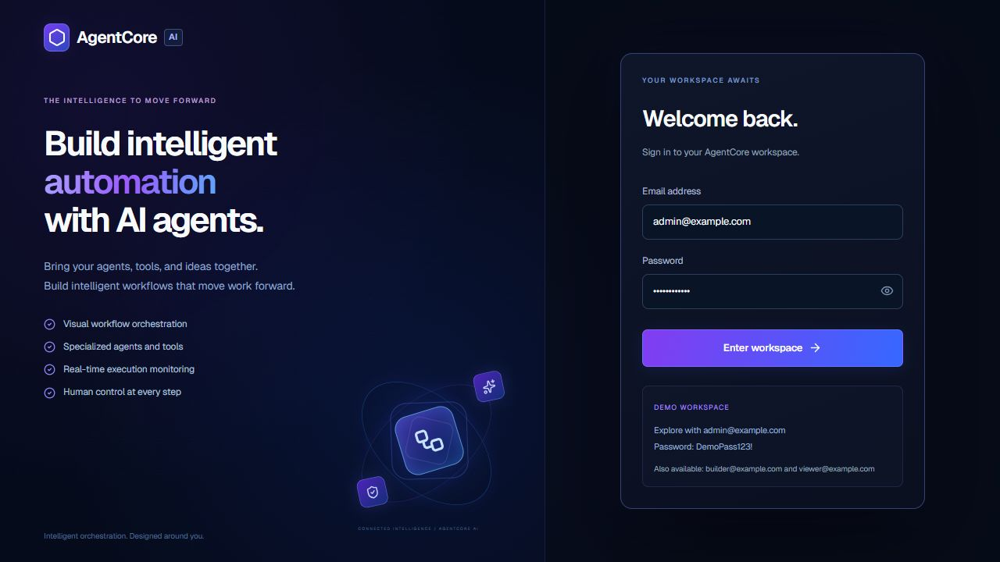
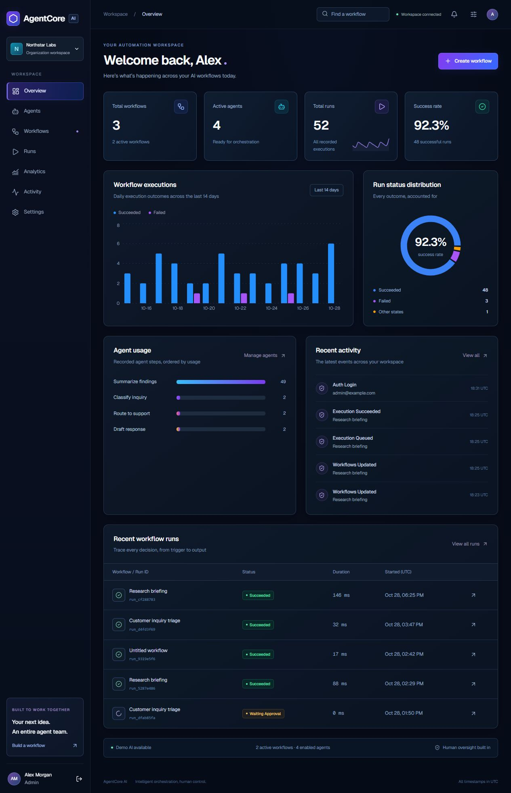
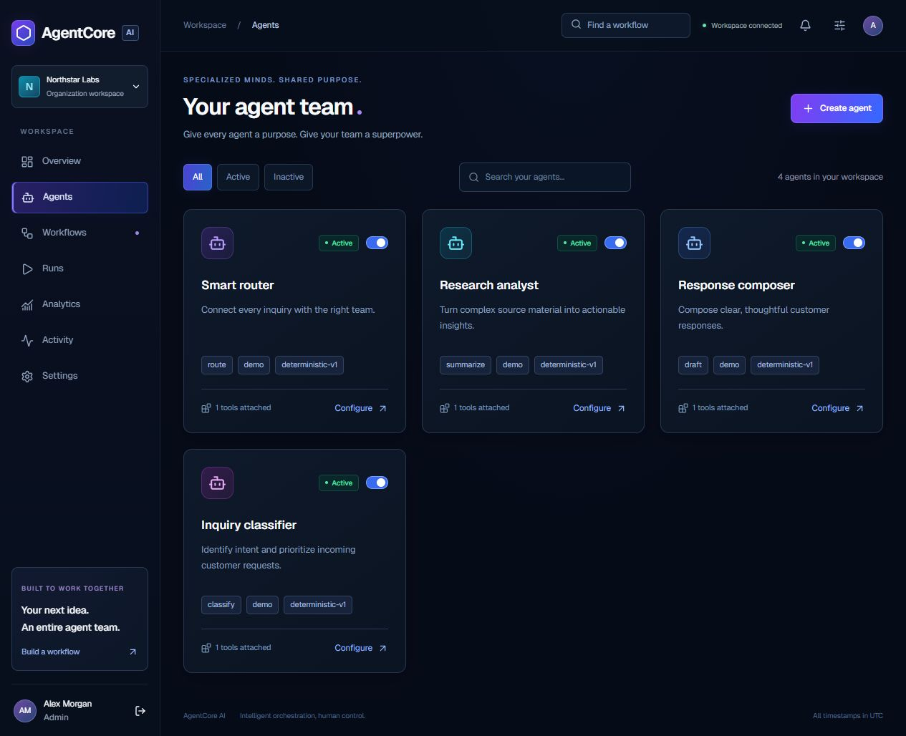
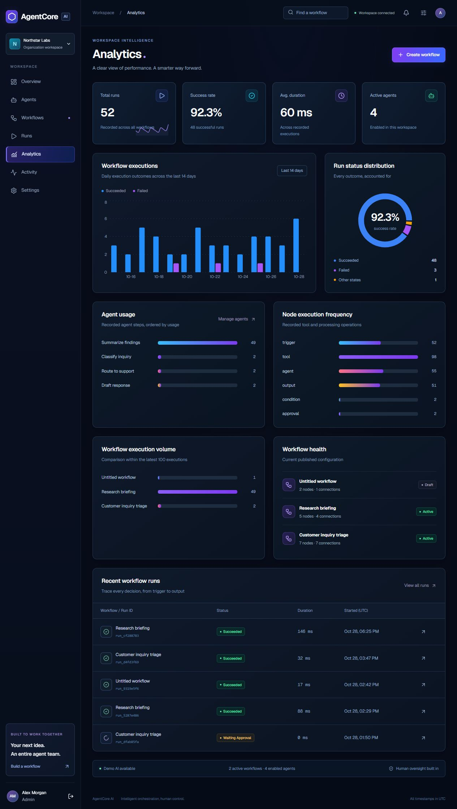

<div align="center">



# AgentCore AI

**A visual workspace for building, running, and understanding AI automation.**

Connect specialized agents and tools into workflows you can inspect, control, and trust.

[](https://github.com/charlesc004/agentcore-ai/actions/workflows/ci.yml)


[Explore the product](#the-workspace) &nbsp;·&nbsp; [See it in action](#from-inquiry-to-reviewed-response) &nbsp;·&nbsp; [Run locally](#run-it-locally) &nbsp;·&nbsp; [Explore the architecture](#built-with-purpose)

<sub>Runs locally without a paid AI API · Persisted execution history · Organization-scoped access</sub>

</div>

<br />

## Automation with a clear line of sight

AI workflows are easier to operate when you can see how decisions are made. AgentCore AI brings the graph, the agent configuration, and the execution record into one connected workspace.

Design a workflow visually. Give each agent a specific responsibility. Route work through conditions, tools, and human review. Then inspect exactly what each step received, produced, and recorded.

| **Build with clarity** | **Execute with control** | **Understand the outcome** |
| --- | --- | --- |
| A node-based studio with a searchable library, configuration inspector, and graph history. | Persisted runs with conditional routing, bounded retries, cancellation, and approval checkpoints. | Step-by-step execution records, structured inputs/outputs, and analytics derived from stored data. |

## The workspace

### 01 / Design the workflow

The studio is the center of the application. Add and connect nodes, configure their behavior, validate the graph, and launch a real test execution through the backend.



**Seven node types:** Trigger · AI Agent · Tool · Condition · Delay · Human Approval · Output.

Pan and zoom across the canvas, navigate with the minimap, and undo or redo graph changes. On mobile, select nodes from an inspection list; desktop and tablet provide the editing canvas.

### 02 / See what actually happened

Every run has a persisted timeline. Select a step to explore its input, output, execution records, attempts, duration, and failure details. Approve waiting runs, cancel active work, or retry a failed workflow as a new execution.



### 03 / Operate from one workspace

| Area | What it brings together |
| --- | --- |
| **Overview** | Workflow and agent counts, execution trends, outcomes, recent runs, and audit activity. |
| **Agents** | Purpose-specific roles, provider/model selection, instructions, tool metadata, and enabled state. |
| **Analytics** | Recorded execution volume, success distribution, agent steps, node frequency, and workflow comparisons. |
| **Activity** | A searchable organization audit trail with actors, actions, and related resources. |
| **Settings** | Organization configuration, account information, provider details, and notification preferences. |

<details>
<summary><strong>Open the complete product gallery</strong> — authentication, overview, agents, and analytics</summary>

| Authentication | Overview |
| --- | --- |
|  |  |

| Agents | Analytics |
| --- | --- |
|  |  |

All six screenshots come from the running production frontend with persisted demonstration data. They are included in [`docs/screenshots`](docs/screenshots).

</details>

## From inquiry to reviewed response

One of the included workflows shows how classification, routing, generation, and human oversight fit together:

```text
Incoming inquiry
      │
      ▼
Classify intent ──► Check priority
                         │
              ┌──────────┴──────────┐
              │ urgent              │ standard
              ▼                     │
      Route to support              │
              └──────────┬──────────┘
                         ▼
                  Draft response
                         │
                         ▼
                  Human approval
                         │
                         ▼
                  Structured result
```

1. **Compose.** Connect nodes and assign enabled agents from the current organization.
2. **Validate.** Check graph structure, connection semantics, reachability, and cycle rules.
3. **Execute.** Persist a graph snapshot and run connected steps in topological order.
4. **Review.** Pause at an approval node until an authorized user continues the execution.
5. **Inspect.** Explore the final result and each step's recorded data in the monitor.

A second included workflow, **Research briefing**, parses source text, summarizes it, and formats a structured brief. Both examples work with the deterministic local provider.

## Built with purpose

### Technology, connected to responsibility

| Layer | Stack | Why it is here |
| --- | --- | --- |
| **Frontend** | Next.js 16 · React 19 · TypeScript | App Router pages, reusable UI, and strict application types. |
| **Design system** | Tailwind CSS 4 · CSS tokens · Geist | A consistent navy/violet visual language, responsive layouts, and focus states. |
| **Workflow studio** | React Flow | Custom node cards, connection handles, selection, minimap, and canvas navigation. |
| **Data and forms** | TanStack Query · React Hook Form · Zod | Cached API state, execution polling, and validated configuration forms. |
| **Presentation** | Recharts · Framer Motion · Lucide · Sonner | Recorded-data charts, restrained motion, icons, and interaction feedback. |
| **API** | Python · FastAPI · Pydantic · Uvicorn | REST presentation, typed request validation, and application composition. |
| **Persistence** | SQLAlchemy 2 · Alembic · SQLite / PostgreSQL | ORM records, tenant-scoped queries, transactions, and explicit migrations. |
| **Execution** | BackgroundTasks / Celery · Redis | One execution coordinator with local and worker dispatch paths. |
| **Authentication** | PyJWT · Argon2 through pwdlib | Signed access tokens, hashed passwords, refresh rotation, and role checks. |
| **Delivery and quality** | Docker Compose · GitHub Actions · Pytest · Ruff · ESLint | Deployment definitions and repeatable verification. |

### Architecture that keeps concerns separate

```text
React workspace
      │  Typed API client + session refresh
      ▼
FastAPI presentation
      │  Authentication + role checks + DTO validation
      ▼
Application services
      ├── Catalog + organization-scoped repositories
      ├── Graph validation + execution coordinator
      └── Provider / tool adapters
                   │
                   ▼
          SQLAlchemy persistence
          Graphs · Runs · Steps · Audit
```

The editor manages graph interactions. The backend owns execution and authorization. AI and tool adapters use replaceable contracts; local and Celery execution share the same coordinator. SQLAlchemy models and migrations remain independent of frontend presentation.

<details>
<summary><strong>Browse the repository structure</strong></summary>

```text
backend/
  app/
    core/          Configuration, database, authorization
    shared/        ORM records, DTOs, repositories, catalog service
    modules/       Auth, agents, workflows, executions, analytics, audit
    modules/ai/    Provider contracts and implementations
    modules/tools/ Local tool adapters
    workers/       Celery task adapter
  alembic/         Schema migrations
  tests/           API and execution regression tests
frontend/
  src/
    app/           Next.js App Router pages
    components/    Shell, charts, shared UI, primitives
    features/      Dashboard, agents, workflow studio, run monitor
    hooks/         Shared permission state
    services/      Typed API client and refresh coordination
    styles/        Design tokens and ordered presentation sections
  tests/           Frontend helper and API client tests
docs/              Setup, architecture, audit, verification, screenshots
.github/workflows/ Automated verification
compose.yaml       Container service definitions
```

</details>

## Run it locally

**Prerequisites:** Python 3.12+, Node.js 24+, and npm. Local mode uses SQLite and the built-in deterministic provider.

<details open>
<summary><strong>1. Start the API</strong> · PowerShell</summary>

```powershell
cd backend
python -m venv .venv
.venv/Scripts/python.exe -m pip install -r requirements.txt
Copy-Item .env.example .env
```

Set a random `JWT_SECRET` of at least 32 characters in `backend/.env`, then run:

```powershell
.venv/Scripts/python.exe -m alembic upgrade head
.venv/Scripts/python.exe -m app.seed
.venv/Scripts/python.exe -m uvicorn app.main:app --host 127.0.0.1 --port 8000
```

</details>

<details open>
<summary><strong>2. Start the workspace</strong> · a second terminal</summary>

```sh
cd frontend
npm ci
npm run dev
```

Open **[localhost:3000](http://localhost:3000)**. API documentation is available at **[localhost:8000/docs](http://localhost:8000/docs)**.

</details>

| Demo role | Email | Password |
| --- | --- | --- |
| **Admin** | `admin@example.com` | `DemoPass123!` |
| **Builder** | `builder@example.com` | `DemoPass123!` |
| **Viewer** | `viewer@example.com` | `DemoPass123!` |

Start with **Workflows → Research briefing → Validate → Test run**. Open the resulting run to inspect its timeline and output. Then try **Customer inquiry triage** to explore approval and branching.

**More setup options:** [Linux/macOS, configuration, external AI, and Docker Compose](docs/setup.md). For a production frontend build, use `npm run build` followed by `npm start`.

## Engineering you can inspect

| Concern | Implemented behavior |
| --- | --- |
| **Access boundaries** | Organization-scoped queries and server-side admin/builder/viewer checks. |
| **Execution visibility** | Persisted in-progress steps, attempts, durations, inputs, outputs, and outcomes. |
| **Human oversight** | Approval pauses, authorized continuation, and cooperative cancellation. |
| **Session handling** | Argon2 password hashes, signed access tokens, and hashed rotating refresh tokens. |
| **Frontend behavior** | Request locks, loading/error/empty states, keyboard focus handling, and reduced-motion support. |
| **Data presentation** | Database-derived metrics and nested credential-key redaction in structured JSON display/copy. |

### Verification record

**16 backend tests passed · 9 frontend tests passed · strict TypeScript, lint, and production build passed.**

Local browser checks covered all seven main pages at desktop and mobile widths, form validation, viewer permissions, and a completed five-step execution with persisted output. These are recorded local checks, not a live hosted CI badge.

<details>
<summary><strong>Run the verification commands</strong></summary>

```powershell
cd backend
.venv/Scripts/python.exe -m ruff check .
.venv/Scripts/python.exe -m pytest -q
cd ../frontend
npm run typecheck
npm run lint
npm test
npm run build
```

GitHub Actions repeats the test, lint, type, migration/seed, and frontend build checks on pushes and pull requests. The production build uses Webpack; development uses Turbopack. See the [verification record](docs/verification.md) for environment notes.

</details>

## Current scope

The implemented engine supports manually started, acyclic workflows with sequential execution, conditional branches, bounded retries, explicit tool nodes, and human approval. Built-in tools format JSON, parse text, draft email payloads, and perform bounded delays.

The deterministic provider enables the complete local demonstration. External AI requires server-side credentials. Agent tool selections are metadata; autonomous tool calling, schedules, webhooks, SSO, invitations, and email delivery are outside the current implementation.

Local SQLite/background-task mode is verified. Docker/PostgreSQL/Redis/Celery and external AI calls need separate environment verification. Public deployment also requires session and infrastructure hardening. See [technical boundaries](docs/technical-reference.md) and the [project audit](docs/project-audit.md) for the complete operational scope.

## Go deeper

| Guide | Start here for |
| --- | --- |
| [Setup and configuration](docs/setup.md) | Local installation, Linux/macOS, environment variables, demo access, and Docker. |
| [Architecture](docs/architecture.md) | Service boundaries, persistence, authorization, and deployment considerations. |
| [Workflow engine](docs/workflow-engine.md) | Graph execution, branch pruning, approval, and retry behavior. |
| [Design system](docs/design-system.md) | Tokens, styling organization, motion, and responsive interactions. |
| [Technical reference](docs/technical-reference.md) | API routes, security behavior, and detailed implementation limits. |
| [Audit and verification](docs/project-audit.md) | Resolved findings, review scope, and test evidence. |
| [Publishing](docs/publishing.md) | Git setup and release archive contents. |

<br />

<div align="center">

**AgentCore AI**

Intelligent orchestration. Human control.

[Back to top](#agentcore-ai)

</div>
